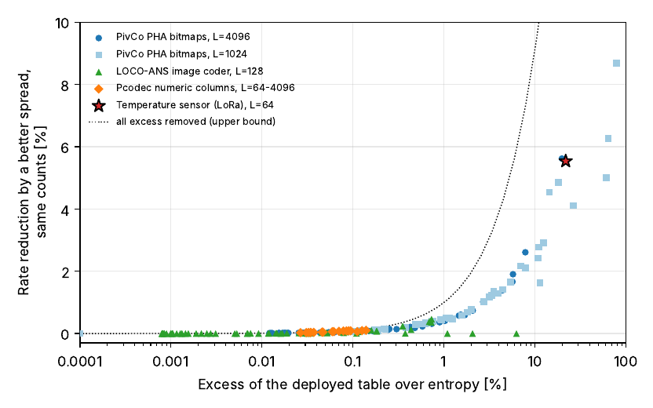
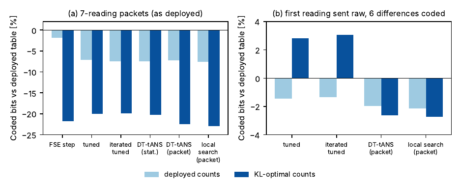
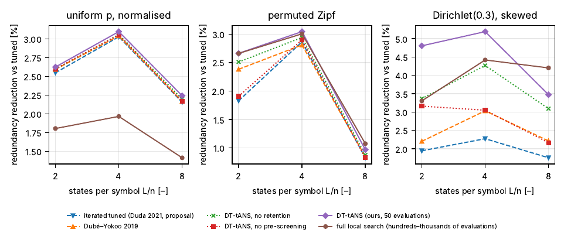
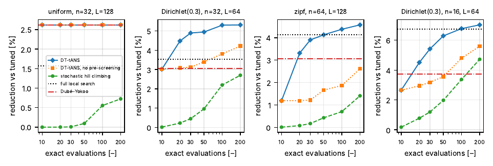
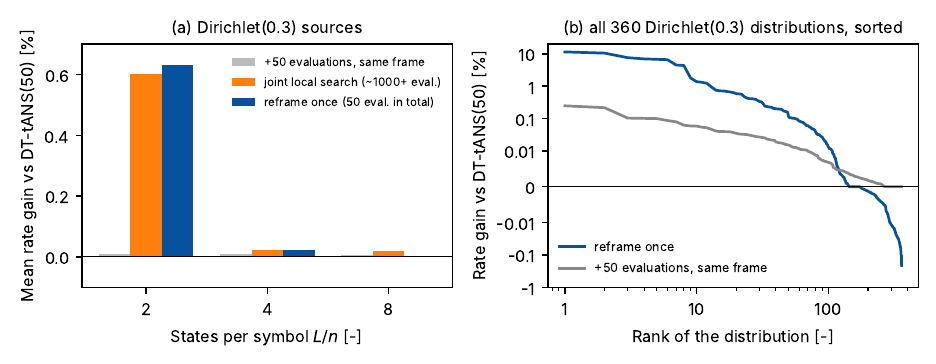
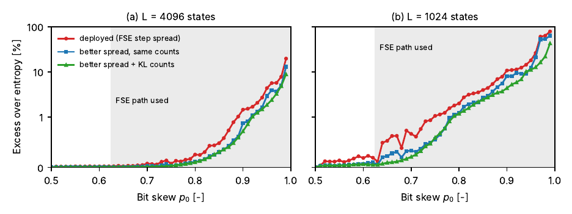

# tans-iterate-test

Code, data and results for the article **"Better symbol spreads for static tANS tables: a pre-screened iterate–test search evaluated on deployed entropy coders"** by Paweł Kuraś (Kozminski University), Patryk Organiściak and Alicja Gerka (Rzeszów University of Technology), Maciej Gacek (University of Information Technology and Management in Rzeszów) and Faustyna Misiura (Jan Grodek State University in Sanok), submitted to *Signal Processing*.

A tabled asymmetric numeral systems (tANS) coder is fixed by its quantised counts and its symbol spread. We build both with the iterate–test loop of a convergence theorem for design thinking ([arXiv:2611.03034](https://arxiv.org/abs/2611.03034)): swaps of table positions are pre-screened by a score from the value function of the coder's state chain, the best tables are retained, and the quantisation is treated as the frame and changed once. The output is an ordinary tANS table; decoders need no change.

## Main results

| | |
|---|---|
| Evaluations to reach full local-search quality | **50** instead of 76–4900 |
| Redundancy of Duda's tuned spread removed (skewed sources, median) | **2.1–7.5%** |
| Single reframe of the quantisation, small skewed tables | up to **11.5%**, 25× the gain of further iteration |
| LoRa temperature sensor (Markiewicz et al. 2025), coded bits | **−22.5%** (−9.3% of payload) |
| PivCo-Huffman prebuilt bitmap tables, skews where they are used | **−0.7 to −9.1%** |
| LOCO-ANS, Pcodec, Zstandard | already within 0.5%, 0.04%, 0.06% of the best |



Better tables recover a third to a half of a deployed table's excess over the entropy. The excess is large for small, skewed, static tables built by hand or with a fast spread (sensor, bitmap tables) and small for large or carefully designed tables.



For short packets the test must be the exact packet cost: optimising the stationary rate made the sensor's packets up to 3% longer, the packet test made them 2.6% shorter.






## Method in brief

* Exact rate of a table from the stationary distribution ρ of the state chain, `exact_rate` in `src/tans.c`.
* Relative value function *h* of the chain (`value_function` in `src/tanslib.py`); in 1618 of 1620 spreads *h* is nondecreasing, which makes Duda's iterated tuned spread a first-order policy-improvement step.
* Pre-screening score of swapping positions *i* < *j*: (ρ<sub>i</sub> − ρ<sub>j</sub>)(*h*<sub>j</sub> − *h*<sub>i</sub>).
* DT-tANS (`dt_tans`, `dt_loop` in `src/tanslib.py`): start from the better of the tuned and iterated tuned spreads; per round test exactly the two best-scored untested swaps of a parent drawn from the three best tables.
* DT-tANS-R (`dt_reframe` in `src/reframe.py`): half the budget in the KL frame, then one reframe to counts corrected by the symbol costs of the best table or to the nearest KL neighbours, each pre-screened with one tuned-spread test.
* Exact packet cost for short packets from a fixed initial state (`packet_cost` in `src/iot2.py`).

## Repository layout

```
src/        C core (tans.c), enumeration (enum.c), throughput benchmark (bench.c), Python library and experiment scripts
results/    raw results (JSON) used for every number and figure in the article
fig/        figures (PDF and PNG)
external/   fetch.sh clones the deployed coders at pinned commits (ans-iot, pivco-huffman, LOCO-ANS)
corpus/     byte corpus for the Zstandard experiments (not redistributed, see corpus/README.md)
```

## Reproducing

```
pip install -r requirements.txt
make                      # builds src/libtans.so, src/enum, src/bench
./external/fetch.sh       # deployed coders and the sensor data
cd src
```

| Article | Script | Result |
|---|---|---|
| Exhaustive enumeration, L = 16, n = 3 | `./enum p1 p2 p3` | `results/enum_*.json` |
| Observation 1 (monotone *h*) | `check_monotone.py` | `results/monotone.json` |
| Synthetic benchmark, Fig. 1, Table 2 | `run_s2.py uniform,zipf`, `run_s2.py dirichlet0.3`, `fig_v3.py` | `results/s2_*.json` |
| Anytime comparison, Fig. 2 | `run_s3.py`, `fig_v3.py` | `results/s3.json` |
| Byte data (supplement) | `run_s4.py` | `results/s4.json` |
| Tables tuned from noisy traffic tests (supplement) | `run_e3.py`, `run_e3b.py` | `results/e3.json`, `results/e3b.json` |
| Ties among equally good tables | `run_ties.py` | `results/ties.json` |
| Earlier benchmark of constructions | `run_s1.py` | `results/s1.json` |
| Reframing, Fig. 3 | `run_reframe2.py`, `fig_v4.py` | `results/reframe_synth2.json` |
| Deployed tables, Table 3, Fig. 4 | `fig_deploy.py` | — |
| LoRa sensor, Fig. 5 | `run_iot.py`, `iot2.py`, `iot3.py`, `iot_reframe.py`, `iot_pareto.py` | `results/iot*.json` |
| PivCo-Huffman tables, Fig. 6 | `run_pha.py` | `results/pha.json` |
| LOCO-ANS tables | `run_loco.py` | `results/loco.json` |
| Pcodec | `run_pco.py` (parses Pcodec 1.1.0 output, `pco_parse.py`) | `results/pco.json` |
| Reframing on deployed tables | `run_reframe_deploy.py` | `results/reframe_deploy.json` |
| Zstandard frames (RFC 8878 parser `zstd_fse.py`) | `run_z1.py 1|3|19`, `run_z2.py`, `run_z3.py ../corpus/py.bin` | `results/z*.json` |
| Throughput | `run_bench.py` | `results/bench*.json` |
| Data-centre estimate (supplement) | `run_dc.py` | `results/dc_sim.json` |

Results were produced with Python 3.13, NumPy 2.5, SciPy 1.18, gcc 13.3 on Linux x86-64.

## Data sources

* Temperature sensor: M. Markiewicz et al., *Energy and Buildings* 346 (2025) 116160, data and firmware at [mmr01/ans-iot](https://github.com/mmr01/ans-iot).
* PivCo-Huffman: M. Żukowski, [paper](https://marcinzukowski.github.io/pivco-huffman/paper-1.0/ph.html) and [code](https://github.com/MarcinZukowski/pivco-huffman); tables rebuilt from the generator's rules.
* LOCO-ANS: T. Alonso et al., *IEEE Access* 9 (2021), table files from [hpcn-uam/LOCO-ANS](https://github.com/hpcn-uam/LOCO-ANS).
* Pcodec: M. Loncaric et al., [arXiv:2502.06112](https://arxiv.org/abs/2502.06112), Python package `pcodec` 1.1.0; numerical columns from `vega_datasets`.

## Citation

See `CITATION.cff`. The underlying theory: P. Kuraś, A. Michalski, A. Gerka, P. Organiściak, *When does design thinking work? A convergence theorem for the iterate–test core*, [arXiv:2611.03034](https://arxiv.org/abs/2611.03034).

## Licence

MIT, see `LICENSE`. External code and data fetched by `external/fetch.sh` keep their own licences.
